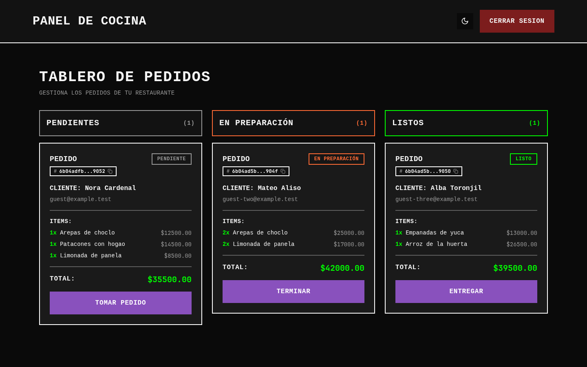
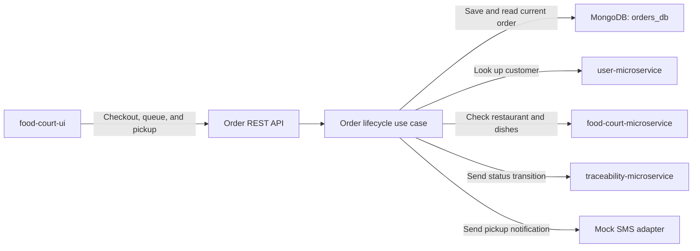

<!-- markdownlint-disable-next-line MD041 -->
<div align="center">

<h1>Food Court — Order API</h1>

<p><strong>The order lifecycle for diners and kitchen staff, from checkout to pickup.</strong></p>

<p>
<a href="https://github.com/diegnghtmr/order-microservice/actions/workflows/ci.yml"></a>


<a href="LICENSE"></a>
</p>

<p>
<a href="https://diegnghtmr.me/en/work/food-court/"><strong>Case study</strong></a> &bull;
<a href="#quick-start"><strong>Quick start</strong></a> &bull;
<a href="#architecture"><strong>Architecture</strong></a> &bull;
<a href="https://github.com/diegnghtmr/food-court-ui"><strong>Web app</strong></a>
</p>

</div>

<p align="center"></p>

*The Food Court kitchen board calls this API to claim orders, mark them ready, and confirm pickup.*

Checkout and pickup need to agree on which dishes were ordered, who is preparing them, and when they can be handed over. This service checks the order against the catalog, stores its current state, and makes the next actions available to diners and kitchen staff. It sends status changes to a separate service for order history.

## Features

- **Checkout validation.** Check that the restaurant exists, its dishes are available and belong to it, and the customer has no active order.
- **Kitchen assignment.** Staff can list the restaurant queue, take a pending order, and mark work in preparation as ready.
- **Pickup PIN.** Confirm handoff only after the employee supplies the correct code; the bundled notification adapter mocks SMS delivery.
- **Customer tracking and cancellation.** Expose order details and let a customer cancel while the order is still pending.
- **Transition reporting.** Send status changes to Traceability after updating the order; a failed trace call does not roll the update back.

## Quick start

Use JDK 25 and Docker with Compose; Gradle 9.2.1 comes from the wrapper. Start MongoDB in Compose and run the API on the host so it can use the checked-in localhost URLs for the other services.

```sh
git clone https://github.com/diegnghtmr/order-microservice.git
cd order-microservice
docker compose up -d order-mongodb
./gradlew bootRun
```

API: `http://localhost:8092/order-api`. Open [Swagger UI](http://localhost:8092/order-api/swagger-ui.html) for the routes under `/orders`, including assignment, ready, delivery, and cancellation.

Start [Identity, Catalog, and Traceability](#related-repositories) to try the full workflow. The UI case study uses a seeded restaurant. See the [configuration reference](docs/reference.md#data-store-and-environment) if any of the services runs on a different port.

## Architecture

Spring MVC controllers delegate to application handlers and the framework-free order use case. MongoDB stores the current order; Feign adapters call the other Food Court services. Traceability keeps historical transitions separately, so history can be incomplete if a trace write fails.



### Ports and adapters

See the [adapter map](docs/reference.md#ports-and-adapters) for the interfaces that separate the order rules from MongoDB, sibling APIs, and notifications.

## Tech stack

| Layer | Technology |
| --- | --- |
| HTTP and security | Java 25, Spring Boot 4.0, Spring MVC, Spring Security, JJWT |
| Integrations | Spring Cloud OpenFeign, MapStruct, springdoc OpenAPI |
| Persistence | Spring Data MongoDB |
| Build and tests | Gradle 9.2.1, JUnit Platform |

## Testing

```sh
./gradlew build
```

[CI](.github/workflows/ci.yml) builds and tests on Temurin 25. Use `./gradlew test` for the test task, which includes domain rules for order creation and the status lifecycle.

## Documentation

- [Order API reference](docs/reference.md) — checkout and kitchen endpoints, MongoDB and sibling service settings, ports and adapters, and system diagrams.

## Related repositories

| Repository | Role |
| --- | --- |
| [food-court-ui](https://github.com/diegnghtmr/food-court-ui) | Cart, order status, and kitchen board |
| [food-court-microservice](https://github.com/diegnghtmr/food-court-microservice) | Restaurants, dishes, and availability used at checkout |
| [user-microservice](https://github.com/diegnghtmr/user-microservice) | Roles, JWTs, and customer lookup |
| [traceability-microservice](https://github.com/diegnghtmr/traceability-microservice) | Stores status transitions and serves history and reports |

## License

Released under the [MIT License](LICENSE).
